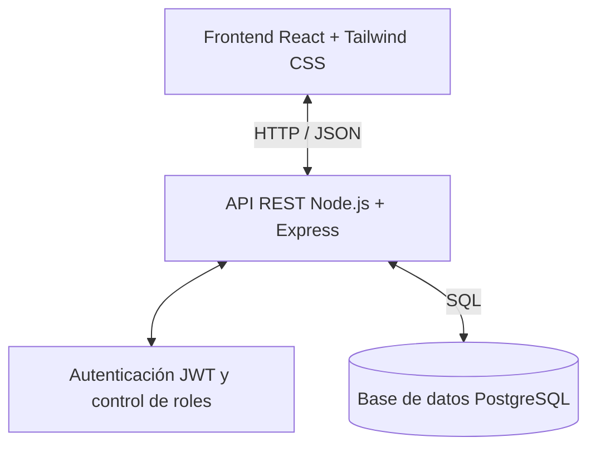

# AyudasXCol


## Descripción

AyudasXCol es una plataforma web desarrollada para facilitar
la gestión, consulta, visualización geográfica y seguimiento
de necesidades y ayudas humanitarias en las comunidades
del departamento del Tolima, Colombia.

El proyecto surge como una propuesta ingenieril orientada
a mejorar la organización y disponibilidad de la información
relacionada con la atención humanitaria.

Este software ha sido desarrollado como proyecto de grado
del programa de Ingeniería de Sistemas de la Universidad
Nacional Abierta y a Distancia (UNAD).

## Objetivo del proyecto

Desarrollar un prototipo web que permita centralizar la
información relacionada con las comunidades, necesidades
y ayudas humanitarias, facilitando su consulta, registro
y seguimiento.

## Funcionalidades

- Dashboard con indicadores generales.
- Gestión de comunidades.
- Mapa interactivo con georreferenciación.
- Gestión de necesidades humanitarias.
- Verificación de necesidades.
- Gestión de organizaciones.
- Registro de ayudas humanitarias.
- Seguimiento del estado de las entregas.
- Filtros avanzados de búsqueda.
- Gestión de usuarios.
- Autenticación mediante JWT.
- Control de acceso basado en roles.
- Diseño adaptable a dispositivos móviles.
- Notificaciones mediante SweetAlert2.
- Carga de módulos bajo demanda (Lazy Loading).

## Tecnologías utilizadas

### Frontend

- React
- Vite
- JavaScript
- Tailwind CSS
- React Router
- Leaflet
- React Leaflet
- OpenStreetMap
- Lucide React
- SweetAlert2

### Backend

- Node.js
- Express
- JSON Web Token (JWT)
- Bcrypt.js
- Express Rate Limit
- Dotenv
- CORS

### Base de datos

- PostgreSQL

### Herramientas de desarrollo

- Visual Studio Code
- pgAdmin 4
- Git
- GitHub
- Figma
- Lucidchart

## Arquitectura del sistema

AyudasXCol utiliza una arquitectura cliente-servidor
organizada en tres capas:



## Estructura del proyecto

```text
AyudasXCol/
├── backend/
│   ├── middlewares/
│   ├── routes/
│   ├── scripts/
│   ├── db.js
│   ├── server.js
│   ├── package.json
│   └── .env.example
├── frontend/
│   ├── public/
│   ├── src/
│   │   ├── components/
│   │   ├── context/
│   │   ├── layouts/
│   │   ├── pages/
│   │   ├── services/
│   │   └── utils/
│   ├── package.json
│   └── .env.example
├── database/
│   └── schema.sql
├── docs/
├── .gitignore
└── README.md
```

## Roles de usuario

| Funcionalidad | Administrador | Organización |
|---|---|---|
| Consultar comunidades | Sí | Sí |
| Registrar comunidades | Sí | No |
| Consultar necesidades | Sí | Sí |
| Registrar necesidades | Sí | No |
| Verificar necesidades | Sí | No |
| Consultar organizaciones | Sí | Sí |
| Registrar organizaciones | Sí | No |
| Consultar ayudas | Sí | Sí |
| Registrar ayudas | Sí | Solo propias |
| Confirmar entregas | Sí | Solo propias |
| Restablecer entregas | Sí | No |
| Gestionar usuarios | Sí | No |

## Requisitos de instalación

- Node.js 22.12 o superior de una versión compatible con Vite.
- npm.
- PostgreSQL 16 o compatible.
- Git.
- Conexión a internet para visualizar el mapa.

## Instalación y ejecución

### 1. Clonar el repositorio

```bash
git clone https://github.com/herreradeveloper7-cell/AyudasXCol.git
cd AyudasXCol
```

### 2. Configurar la base de datos

Crear una base de datos en PostgreSQL llamada:

```sql
CREATE DATABASE ayudasxcol_db;
```

Importar la estructura desde el archivo:

```text
database/schema.sql
```

La importación puede realizarse mediante pgAdmin 4
o utilizando psql.

### 3. Configurar el backend

```bash
cd backend
npm ci
cp .env.example .env
```

Configurar las variables de entorno en el archivo `.env`
con las credenciales correspondientes a la instalación local.

Generar una clave JWT segura:

```bash
node -e "console.log(require('crypto').randomBytes(32).toString('hex'))"
```

Asignar el resultado a la variable JWT_SECRET.

### 4. Crear el administrador inicial

Desde la carpeta backend:

```bash
node scripts/createAdmin.js
```

Ingresar el nombre, correo electrónico y contraseña
del administrador.

### 5. Ejecutar el backend

```bash
npm run dev
```

Servidor:

http://localhost:3001

### 6. Configurar el frontend

Abrir una nueva terminal desde la raíz del proyecto:

```bash
cd frontend
npm ci
cp .env.example .env
```

### 7. Ejecutar el frontend

```bash
npm run dev
```

Aplicación:

http://localhost:5173

## Compilación para producción

Desde la carpeta frontend:

```bash
npm run lint
npm run build
npm run preview
```

Vista previa:

http://localhost:4173

## Seguridad

El sistema incorpora mecanismos de seguridad como:

- Almacenamiento de contraseñas mediante hashes bcrypt.
- Autenticación basada en JWT.
- Protección de rutas del frontend y backend.
- Autorización basada en roles.
- Validación de datos de entrada.
- Consultas SQL parametrizadas.
- Restricciones de operaciones por organización.
- Limitación de intentos de inicio de sesión.
- Protección de credenciales mediante variables de entorno.

## Metodología de desarrollo

El proyecto se desarrolla bajo la metodología CDIO:

1. Concebir.
2. Diseñar.
3. Implementar.
4. Operar.

## Calidad y rendimiento del software

Durante el desarrollo se realizaron procesos de
refactorización, optimización y pruebas funcionales.

| Indicador | Antes | Después |
|---|---:|---:|
| Paquete principal JavaScript | 563.69 kB | 354.00 kB |
| Tamaño comprimido gzip | 164.32 kB | 109.25 kB |
| Errores ESLint | 5 | 0 |
| Advertencias ESLint | 1 | 0 |
| Advertencias Vite | 1 | 0 |

La optimización mediante Lazy Loading y Code Splitting
permitió reducir aproximadamente un 37.2 % el tamaño
del paquete principal de JavaScript.

## Pruebas del software

- Pruebas funcionales.
- Pruebas de integración.
- Pruebas de autenticación.
- Pruebas de autorización.
- Pruebas de persistencia de datos.
- Pruebas de regresión sobre el frontend compilado.

## Autores

Javier Steeven Herrera Pacheco
Jeferson David Comba Moreno

Proyecto de grado - Ingeniería de Sistemas.

Universidad Nacional Abierta y a Distancia (UNAD).

Colombia - 2026.

## Estado del proyecto

Prototipo funcional desarrollado con fines académicos.

El sistema utiliza información simulada para pruebas
en un entorno controlado. No representa registros
oficiales de atención humanitaria.

No está destinado actualmente a una operación real
con información sensible de comunidades vulnerables.
